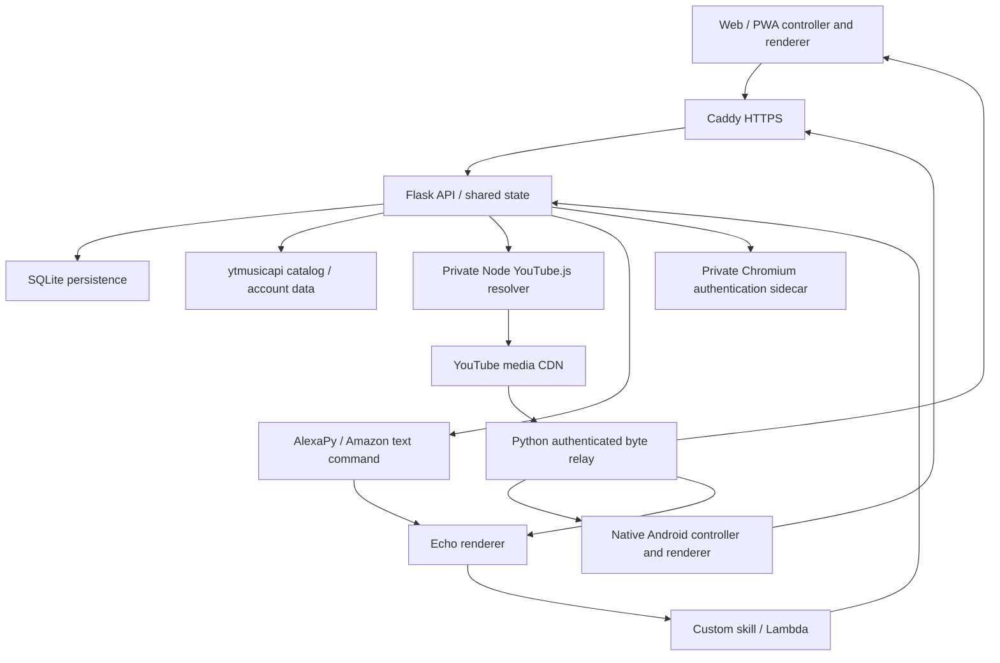

# Music Box backend architecture

Verified against `master` at `08139f16aac382d80703d59104838c4ecd1fb40a`, 2026-10-25. [Changelog](CHANGELOG.md) · [Android architecture](https://github.com/arookiecoder-ip/MusicBox-APP/blob/feat/alexa-backend/ARCHITECTURE.md).

## Runtime and authority

One owner can operate multiple browser/phone/Echo renderers and invite restricted Jam guests. One Flask process is authoritative for shared queue and output state. The supported Docker image runs Waitress with 16 threads; ownership locks, leases, queue decisions, URL caches and in-memory counters are process-local. Multiple independent WSGI processes/replicas would split that authority.

An accepted HTTP request, prepared URL, opened proxy connection, `PlaybackStarted` event and audible output are separate stages. UI optimism must reconcile with renderer confirmation and cannot grant ownership.

## Components

| Path | Responsibility |
| --- | --- |
| [flask-server/server.py](flask-server/server.py) | HTTP composition, account/catalog routes, shared queue/output coordination, skill webhooks, web UI and integration boundaries. |
| [youtube_stream.py](flask-server/youtube_stream.py) | Bounded worker RPC, authenticated progressive relay, ranges, stream capacity and sanitized errors. |
| [youtube-stream/resolver.mjs](flask-server/youtube-stream/resolver.mjs) | Persistent YouTube.js YTMUSIC session, pinned AAC format, bounded/coalesced URL resolution and credential/player reset. |
| [current_audio.py](flask-server/current_audio.py) | One temporary current-track file, sparse range accounting, validators and generation-fenced retention. |
| [audio_jobs.py](flask-server/audio_jobs.py) | Bounded, keyed URL-preparation pool with foreground priority and limited speculative work. |
| [playback_output.py](flask-server/playback_output.py), [playback_contract.py](flask-server/playback_contract.py) | Output tokens/leases/revisions and monotonic failed-command rollback. |
| [queue_commands.py](flask-server/queue_commands.py) | Bounded idempotent command replay protection. |
| [playback_store.py](flask-server/playback_store.py) | Stable queue occurrences and coalesced durable metadata writes. |
| [mobile_devices.py](flask-server/mobile_devices.py), [playback_failover.py](flask-server/playback_failover.py) | Device presence, command delivery, bounded waits and eligible disconnected-owner fallback. |
| [audio_credentials.py](flask-server/audio_credentials.py) | Audio-only session credentials and validation. |
| [alexa_remote.py](flask-server/alexa_remote.py) | Amazon session/login proxy, online device checks and custom-skill transport dispatch. |
| [youtube_browser_session.py](flask-server/youtube_browser_session.py), [browser-auth](browser-auth) | Owner-protected browser session, captured headers and persistent Chromium profile. |
| [playlist_paging.py](flask-server/playlist_paging.py), [artist_releases.py](flask-server/artist_releases.py), [home_feed.py](flask-server/home_feed.py) | Provider normalization, catalog paging and feed assembly. |
| [status_monitor.py](flask-server/status_monitor.py), [status_journal.py](flask-server/status_journal.py) | Bounded process/request/resource telemetry and operational journal. |
| [templates/static/js](flask-server/templates/static/js) | Web state acceptance, local browser rendering, device presence and UI. |
| [lambda/lambda_function.py](lambda/lambda_function.py), [player.py](lambda/mediaUtils/player.py) | Custom-skill intents, AudioPlayer events, exact armed plays and authoritative successor requests. |

## Progressive audio

1. A controller selects a video/collection. Generation/intent is captured before slow metadata or URL work.
2. Python sends bounded RPC to a private persistent Node worker, initialized in the background. The worker resolves the chosen video's playable URL with the current cookie/session generation.
3. The resolver pins AAC/MP4 itag 140 and returns private media metadata to Python. Signed upstream URLs remain internal in the supported proxied deployment.
4. Python authorizes the caller and relays upstream bytes progressively, including HEAD/ranges/validators and response validation. The caller need not wait for a complete file.
5. Received bytes may be reused for the confirmed current track only. Next-track URL warming and Echo prebuffering cannot evict the song still audible.

`/audio/` is the app/browser path and must not acquire Echo playback. `/proxy/` serves Echo with its playback/ownership confirmation rules. `info=1` is metadata; `prefetch=1` prepares a URL; `wait=1` remains compatible without imposing download-first behavior. Explicit downloads stream as client downloads rather than creating a server song library.

The normal Docker playback path uses YouTube.js, not a fresh yt-dlp process per song. yt-dlp remains in legacy/provider validation/diagnostic integrations and dependency/configuration names; it is not evidence that current progressive playback downloads an entire song first. Resolver startup/cookie rotation, provider decipher changes, network cold starts and worker recovery can still add latency. Warmup prepares session/player/URLs, not a permanent collection of audio files.

## Retention, bounds and failure handling

| Resource | Current bound / behavior |
| --- | --- |
| Current audio bytes | One anonymous temporary file, at most 64 MiB retained bytes and 512 tracked ranges. Sparse holes are never served as valid audio. |
| URL cache | Up to 128 entries; at most five minutes and less near signed expiry. Bound to cookie/session generation. |
| Resolver work | Four concurrent resolutions; duplicate requests coalesce. |
| Active audio responses | Eight response slots; capacity exhaustion is retryable. |
| Preparation pool | Four workers, at most 16 unique queued/running jobs; speculation limited to two workers/jobs, with demand promotion. |
| Device presence | 15-second TTL; negotiated waits up to eight seconds do not themselves renew a disconnected device. |
| Command/error/diagnostic history | Bounded stores/journal/payloads; no unbounded request-thread fan-out for preparation. |

Disk-full or retention-cap errors can disable further temporary retention while streaming continues. Old-generation writers cannot recreate retired current audio. Process exit releases its anonymous file. This is not a persistent LRU or a 5/10 GiB song budget.

An upstream 403/410 can refresh the signed URL once before sending audio. After bytes have been sent, the relay does not silently splice another encoding or restart from byte zero. Disconnects close upstream sockets and release capacity. Interrupted players retry with ranges; unavailable/unsupported content and temporary provider/network errors have distinct bounded error contracts. Cookie replacement resets worker/session/URL state. Worker death/hang and decipher refresh are bounded; rate limits suppress speculative storms.

The phone's rolling current/next-five cache and explicit offline downloads are independent client stores. Browser media buffering and Home/catalog/artwork caches are also separate from server current-audio retention.

## Shared queue and output protocol

Queue entries have stable occurrence IDs, so the second instance of video A is different from the first. Publications carry exact cursor/index, command ID and expected revision as appropriate. Queue mutation checks, application and replay recording are serialized; malformed/stale operations fail before mutation. Full phone publications remain authoritative while that phone owns the valid token.

Output state carries mode, owner/receiver, opaque token, epoch and revision. Playback snapshots have a revision within that output generation. Lower revisions are rejected; a rejected mutation can restore previous content only with a newer revision. New server epochs can reset local counters, while retired-epoch snapshots stay rejected by clients.

Handoffs preserve source occurrence, cursor and play intent. Destination authorization/preparation and source pause acknowledgment are token-bound. A native source can acknowledge its actual pause directly rather than waiting for another slow poll. An expired/superseded acknowledgment cannot reset destination progress or release a different owner's audio. Presence/lease renewal remains active during preparation, independent of UI loading.

SQLite persists shared queue/cursor/output preference through coalesced writes. Restart restores **paused metadata**, not an active phone lease or proof that any device is still playing. Online recovery revalidates ownership; disconnected devices cannot be globally exclusive until communication resumes.

## Browser refresh, close and remote control

[ui-state.js](flask-server/templates/static/js/ui-state.js) is the web snapshot acceptance boundary. [browser-player.js](flask-server/templates/static/js/browser-player.js) renders audio locally with the same output/token/acknowledgment protocol as phones. It binds seeks to song/occurrence, retains pending seeks while loading and avoids clamping a catalog duration to the exact media end in a way that accidentally advances the queue.

A refresh reuses the browser identity within a short reconnect grace rather than immediately declaring the renderer offline. A real close/unload or expired presence can move active playback to an eligible foreground receiver under a checked transfer; it must not arbitrarily select another online device on refresh or auto-play a merely saved/paused queue. Lost unload delivery falls back to TTL behavior.

The web client uses finite JSON state reads and action-triggered refreshes. Current base polling in `ui-state.js` is 500 ms when foreground or processing, 5 seconds background-playing, 30 seconds background-paused; failures back off to at most 60 seconds. Presence can wake commands/handoffs promptly. [sse.js](flask-server/templates/static/js/sse.js) is a historical filename, not proof of permanent SSE: `/alexa/now_playing/stream` emits one snapshot and closes to avoid exhausting Waitress threads.

The Android client independently uses presence-triggered state refresh plus a 5-second healthy foreground backup, fast processing/unhealthy fallbacks and its own local clock. Do not apply one client's poll constants to every renderer.

## Alexa dispatch, buffering and final-second recovery

The remote arms an exact video ID and offset, then sends a short NLU-safe custom-skill text command through AlexaPy. The skill consumes `/armed_play/`; sensitive IDs/offsets do not depend on speech recognition parsing. Default dispatch debounce is 150 ms, with an in-flight-trigger guard, coalescing and bounded confirmation retry. HTTP acknowledgment is not playback confirmation.

AudioPlayer callbacks include the exact stream token and original event timestamp. Tokens distinguish repeated songs/same-song restarts. An old stop/finish/failure cannot replace a newer stream or poison the event watermark. Pending Next/seek state is staged before sending a command, so a very fast start event is not overwritten when dispatch returns.

For next-track buffering:

1. The skill requests `/next_track/` with its current token/protocol context.
2. The backend resolves the successor from the live queue and returns a decision tied to output token, intent, occurrence and queue signature/revision.
3. The skill validates again after stream lookup before emitting ENQUEUE. It does not resurrect its stale local window on an authoritative queue end or failed lookup.
4. A queue edit can request token-checked replacement of the buffered successor. If the old buffered song nevertheless starts at delivery time, at most one fenced correction resolves the currently desired successor.

A custom skill cannot emit Play from `PlaybackStarted` or `PlaybackFinished`; normal next-stream directives belong in `PlaybackNearlyFinished`. Starting/seeking inside the final window can therefore miss an enqueue opportunity. The server's finish-recovery grace is 1.5 seconds: if no real start/user action supersedes it, it checks song, stream token, intent and output ownership again. It promotes only valid prefetch evidence or dispatches the **current live successor** as an unconfirmed transition. A deleted buffered row cannot be promoted. Valid loop prefetch remains accepted, finite queues do not invent a wrap, and explicit Pause/new selection/phone ownership cancels recovery.

Repeated callbacks cannot skip arbitrary extra songs. Provider/device failure auto-advance has a separate bounded budget (up to five consecutively failed songs); new transport intent cancels delayed recovery. Device presence is refreshed/expired rather than treating a stale cached Echo entry as reachable.

Absolute seek uses Play with `offsetInMilliseconds`, so stream/skill/device startup remains. Paused seeks change the frozen cursor without starting audio; resume uses that cursor. See the [official AudioPlayer reference](https://developer.amazon.com/en-US/docs/alexa/custom-skills/audioplayer-interface-reference.html) and [queue protocol notes](docs/alexa-queue-reconciliation.md).

## Authentication boundaries

Owner web sessions, optional TOTP, JSON mutation/CSRF checks and live-session revocation protect account/control APIs. Jam is a restricted guest capability, not an owner login. Status details and error acknowledgment retain owner authorization even when subroutes are called directly.

`audio_credentials.py` issues scoped audio tokens after owner-session authentication (two hours playback, 24 hours downloads). They do not authorize account or queue mutations. Historical skill/global-key access remains for compatibility; current Android BuildConfig embeds no global server key. Audio authorization and range delivery remain in Flask rather than exposing temporary media directly through Caddy.

Catalog account headers and audio cookies have separate validation/replacement paths. The private sidecar launches ordinary Chromium for interactive Google login, captures a signed-in browse request after handoff, validates it and atomically promotes headers. Its noVNC endpoint requires both owner authorization and a short-lived lease cookie; the controller token is private between services. Account revocation/challenges require renewed login. Amazon's browser-driven login proxy persists a separate Alexa session.

Avoid logging/exporting cookie values, signed URLs, session credentials, captured headers or browser profiles. Stable session signing uses the configured secret or a persisted generated secret beside the database. Preserve the database, auth and profile volumes independently of temporary audio.

## Deployment and source layout

Flask and Chromium have independent bridge networking. Caddy reaches the application and browser directly by service name, with owner `forward_auth` on the desktop route. A separate private gateway binds only its internal-network interface and establishes outbound HTTP/CONNECT tunnels through an authenticated endpoint in the optional Gluetun namespace. VPN connection failures use direct egress before any request body is forwarded. A bounded cooldown restores VPN preference on subsequent connections; in-flight tunnels are never replayed. The lifecycle timer reattaches only the VPN endpoint after container restart/recreation. Application ingress, browser-controller access, startup and direct egress remain independent of VPN availability. Other Caddy site blocks remain independent services.

Artist details expose optional normalized `playlists` and `featured` shelves. The upstream parser omits some artist playlist headings, so a bounded per-client cache extracts them from the original browse response. Optional-shelf failure does not fail the artist page. Additional playable artist shelves retain their item types instead of being silently discarded. Home fetches up to forty native shelves with a combined safety cap of sixty-four, preserves single-item shelves and distinguishes same-title shelves by content. Both clients hide empty shelves and use the existing bounded `/api/artist/<id>/releases?kind=...` pagination contract. Website collection state is encoded as `/artist?channel=...&collection=albums|singles|playlists|featured`, with stale-navigation fencing and retry controls.

A bridge-mode deployment must change upstreams and namespace/controller wiring together. Do not publish Chromium debugging, VNC or controller ports as public substitutes for the protected routes. Use one authoritative Flask process; scale-out needs an explicit redesign of shared ownership/storage, not just more workers.

Rebuild/recreate only `ytmusic` for backend changes that do not alter sidecar/proxy infrastructure. Retain persistent volumes and stable credential paths. Deploy matching backend protocol support before an Android client that relies on scoped credentials or newer handoff responses. Keep the Alexa skill compatible during rollout; code history does not itself prove a Lambda deployment occurred.

## Diagnostics and verification

[STATUS_PANEL.md](docs/STATUS_PANEL.md) describes owner-only request/resource/stream/cookie/journal diagnostics. Current UI has no saved-song cache inventory. Counters are per process; request latency may stop at response headers rather than stream completion. Cookie file shape/expiry and a locally loaded Amazon session do not establish provider acceptance or online audio reachability.

The [regression workflow](.github/workflows/alexa-regressions.yml) runs Node resolver tests, isolated server and JavaScript files, Lambda/controller SDK tests, Python compilation and browser checks. Isolation matters because older test modules install mutually incompatible import stubs. Run [scripts/run-regressions.py](scripts/run-regressions.py) rather than combining all those fixtures in one Python process.

Snapshot evidence: [841 Python tests, 31 JavaScript files, 44 skill tests and 35 browser tests passed](https://github.com/arookiecoder-ip/youtube-music-alexa-skill/actions/runs/40127521237). The companion app passed 444 JVM and 30 API 35 interaction checks. The deterministic boundary suite reproduces deleted-successor, same-song seek/stop, Next/finish, explicit-pause, finite-end and loop-prefetch cases.

A single live probe observed roughly 90 ms seek HTTP acknowledgment and 3.7 seconds to server playback confirmation. That is not audible-output timing or a latency distribution. Its longer boundary attempt was interrupted by a separate Pause request; the original queue/paused position was restored, and no successful live boundary transition is claimed. Streaming notes' first-byte measurements exclude Alexa command/device startup. Physical Samsung/carrier/Bluetooth behavior and battery/FPS improvements require device-specific measurements.
