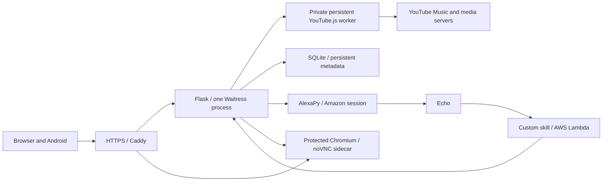

# Music Box backend and Alexa skill

Self-hosted YouTube Music catalog, progressive audio relay, web/PWA player and shared playback control for browsers, Android phones and Alexa Echo devices.

[Architecture](ARCHITECTURE.md) · [Changelog and PR history](CHANGELOG.md) · [Android app](https://github.com/arookiecoder-ip/MusicBox-APP) · [Docker setup](SETUP-DOCKER.md)

Reviewed 2026-10-25 against `master` at `08139f16aac382d80703d59104838c4ecd1fb40a`. The backend is documented by commit/date; Android's 2.4.50 version is not a backend release number.

## What it does

- Personalized YouTube Music Home, search/suggestions, library, artists, albums, playlists, likes and history, with supported account mutations and anonymous fallbacks.
- Progressive AAC/MP4 audio for phone/browser (`/audio/`) and Echo (`/proxy/`) without downloading the complete song before serving it.
- One authoritative shared queue and selected renderer, with occurrence IDs, output leases, acknowledged device commands, revision checks and guarded handoffs.
- Browser playback on “This browser,” remote control from other clients, refresh reconnect grace and foreground-device failover after a real close/disconnect.
- Custom Alexa skill voice controls, live-queue next-track decisions, buffered-successor reconciliation and bounded recovery from end-of-song queue races.
- Owner login with optional TOTP, scoped app audio credentials, Jam guest sharing, protected YouTube reconnect UI and an operational status dashboard.

## Current audio and storage model

The Docker image enables the persistent YouTube.js YTMUSIC resolver in [flask-server/youtube-stream](flask-server/youtube-stream). It initializes its player/session in the background, coalesces bounded URL lookups and relays upstream bytes immediately. Metadata and the short-lived signed-URL cache are different from downloaded audio.

**There is no persistent multi-song server audio cache.** Only received bytes of the current track can be retained in one anonymous temporary file. Confirmed next-track playback replaces it; same-song resume/handoff keeps it; URL warmup and Echo next-song prebuffering do not evict the song still playing. The 64 MiB limit is a per-current-track safety ceiling, not a retained-library budget. Explicit downloads stream to the client.

The Android app independently maintains temporary current/next-five audio and persistent user downloads. Removing server song storage did not remove phone offline playback, account metadata, artwork, URL preparation or the browser's media buffer. See [Streaming audio](docs/STREAMING_AUDIO.md).

## Deployment layout



The [Compose file](docker-compose.yml) gives `ytmusic` and `youtube-browser` independent bridge networking. [Caddyfile.example](Caddyfile.example) reaches `ytmusic:5000`, `ytmusic:5001` and `youtube-browser:6080`; the browser controller is `http://youtube-browser:8765`. Application startup and incoming API traffic do not depend on Gluetun.

Outbound Python, Alexa, Node/YouTube and Chromium requests use a private HTTP CONNECT gateway. It prefers the optional VPN endpoint, falls back to normal networking if connection setup fails within 1.5 seconds, and retries VPN after a 10-second cooldown. TLS remains end to end. Existing interrupted streams reconnect through the normal media retry/Range paths; the gateway does not replay commands or partially sent requests.

Set `MUSICBOX_EGRESS_TOKEN` to a randomly generated secret in `.env` (see [.env.example](.env.example)). `docker compose up -d` works without a VPN. If an existing Gluetun container is available, enable the preferred endpoint with `docker compose --profile vpn up -d --no-deps musicbox-vpn-proxy`. Its private listener uses port 5000 inside Gluetun, which must be allowed from the Docker bridge. Do not publish that proxy port to the host. Music Box does not change the VPN configuration.

Install [the lifecycle timer](scripts/musicbox-vpn-proxy.timer) and adapt [its service example](scripts/musicbox-vpn-proxy.service.example) to the checkout path and Docker-enabled service user to reattach the endpoint after Gluetun restarts or is recreated. The timer manages only `musicbox-vpn-proxy`; neither the application nor direct fallback depends on the timer. Copy the Music Box block from `Caddyfile.example` into your deployment Caddyfile and retain unrelated site blocks.

For a different topology, update Compose network mode, browser-controller URL and Caddy upstreams together. Preserve unrelated site blocks already present in Caddy. The application architecture does not require changing the host's VPN routing during a routine code update.

| Service / volume | Role |
| --- | --- |
| `ytmusic` | Python 3.12, Flask/Waitress (one process, 16 threads), catalog/auth/output APIs, AlexaPy and private Node worker. |
| `youtube-browser` | Private Chromium, Xvfb, x11vnc/noVNC and token-protected authentication controller. |
| `caddy` | Public HTTPS, application/login proxy and owner-authorized noVNC routing. |
| `ytmusic_data` | SQLite state and persistent YouTube headers under `/data`. |
| `ytmusic_alexa_cookies` | Amazon session at `/app/alexa_cookies`. |
| `ytmusic_chromium_profile` | Saved YouTube Music browser profile. Treat it as account credentials. |
| `caddy_data`, `caddy_config` | Caddy TLS/configuration state. |

The old persistent audio-cache volume is no longer mounted. Do not remove data/auth/profile volumes as part of an audio-cache cleanup.

## Setup

1. Clone this repository and review [SETUP-DOCKER.md](SETUP-DOCKER.md), applying the current network layout above. Docker Compose supports the optional `.env` file; `YT_BROWSER_CONTROL_TOKEN` is required by the checked-in configuration.
2. Configure your HTTPS origin and private credentials in `.env`. Generate independent random values rather than using the placeholders below.
3. Provision `cookies.txt` for the bind mount. It can be an empty file for an anonymous attempt; authenticated/restricted playback may require a valid export. Account browsing and audio cookies are separate credentials.
4. Start the prerequisite network/VPN container for this topology, then build/start the application services.
5. Sign in to the Web Remote, connect YouTube Music through its protected browser flow, and connect Amazon if using Echo playback.
6. Deploy the custom skill using [lambda](lambda) and the locale-specific [interaction models](skill-package/interactionModels/custom). Configure the real API key and public backend origin only in the deployed skill's private configuration. The tracked [template](lambda/api_key.py) must remain a placeholder.

Example `.env` keys:

```dotenv
SITE_ADDRESS=music.example.com
PUBLIC_BASE_URL=https://music.example.com
API_KEY=replace-with-an-independent-random-secret
SECRET_KEY=replace-with-a-stable-random-session-secret
REMOTE_USER=your-owner-name
REMOTE_PASSWORD=replace-with-a-strong-password
YT_BROWSER_CONTROL_TOKEN=replace-with-an-independent-random-secret
AMAZON_DOMAIN=amazon.in
```

```sh
# Repository root; after the topology and private files are configured.
docker compose build ytmusic youtube-browser
docker compose up -d
```

For a backend-only update:

```sh
docker compose build ytmusic
docker compose up -d --no-deps ytmusic
docker compose logs --tail=100 ytmusic
```

Keep one authoritative Flask process. Locks, leases, queue decisions and provider caches are process-local; adding WSGI processes/replicas does not safely scale this design. The existing `ytmusic` image also runs the private resolver, so no additional audio container is needed.

## Configuration reference

| Setting | Current purpose |
| --- | --- |
| `PUBLIC_BASE_URL` | Public HTTPS origin used in device-playable backend URLs. It must be reachable by Echo. |
| `SITE_ADDRESS` | Caddy site address. |
| `API_KEY` | Backend/skill shared credential; owner APIs can also use an authorized web session. Prefer headers over putting a key in a URL. |
| `REMOTE_USER`, `REMOTE_PASSWORD` | Both are required to enable owner web login. |
| `REMOTE_TOTP_SECRET` | Optional base32 TOTP secret. |
| `SECRET_KEY`, `SECRET_KEY_FILE` | Stable session signing key; when omitted the server attempts to persist a generated key beside `DB_FILE`. A writable, preserved location is necessary for that fallback to survive restart. |
| `DB_FILE` | SQLite database; Compose sets `/data/data.db`. |
| `YTMUSIC_AUTH_FILE` | Account browser headers; Compose uses `/data/headers_auth.json`. |
| `YTDLP_COOKIES` | Cookie-file path also used by the streaming resolver; Compose mounts the root `cookies.txt` read-only. The legacy name does not mean normal playback invokes yt-dlp per song. |
| `YT_BROWSER_CONTROL_TOKEN` | Same private controller token in Flask and the Chromium sidecar. |
| `YT_BROWSER_SERVICE_URL` | Private browser-controller origin; Compose uses `http://youtube-browser:8765`. |
| `AMAZON_DOMAIN` | Amazon account region, default `amazon.in`. |
| `ALEXA_COOKIE_DIR` | Persisted Amazon session directory. |
| `ALEXA_PROXY_BASE_URL`, `ALEXA_PROXY_PORT` | Public login-proxy origin and internal listener (default 5001). |
| `SKILL_INVOCATION_NAME` | Text/voice invocation name, default `music box`. |
| `PLAY_DISPATCH_DEBOUNCE` | Default 0.15 seconds; coalesces rapid selection bursts before invoking Alexa. |
| `STATUS_LOG_DB` | Optional bounded operational-journal database path. |

The Docker image enables the supported streaming path. Historical `AUDIO_CACHE_MAX_MB`/audio-LRU tuning is not a current song-retention feature, and `wait=1` does not restore download-first playback.

## Authentication and account connection

- **Owner session:** `/login/`, optional TOTP, HttpOnly cookie, JSON mutation/CSRF checks and session revocation. Jam guests do not acquire owner account/status permissions.
- **Scoped phone audio:** authenticated `/api/app/audio-token/` issues audio-only credentials (two hours playback, 24 hours download), validated against the live owner session. These do not grant queue/account mutation access. New Android builds do not embed the server-wide key.
- **YouTube account data:** the owner launches the protected Chromium/noVNC session beneath `/youtube-login/`. Complete Google challenges there. After a validated signed-in browse capture, the server atomically promotes headers to `YTMUSIC_AUTH_FILE`. A saved profile can renew ordinary cookie rotation; revoked/challenged sessions require reconnection. Manual advanced header import remains supported.
- **YouTube audio cookies:** independently tested/replaced through the owner flow. Failed replacements preserve the existing jar. A cookie file's format/expiry is not proof that the provider will accept audio requests.
- **Amazon:** browser-driven login uses the internal login proxy; the resulting session is persisted in the Alexa cookie volume. Server/container outbound routing is the relevant Amazon egress path, not a browser VPN extension.

Do not commit `.env`, cookie/header exports, browser profiles, database files, deployed API keys or private signing material. Preserve data/auth volumes across updates. `docker compose down -v` removes named volumes and is not an ordinary restart procedure.

## Web, phone and Echo control

Open `/remote/` (or the configured root UI) through HTTPS. The Web Remote can render audio on “This browser” or control another online renderer. Playback anchors tick locally and reconcile against backend snapshots; handoff loading, resume loading and ordinary seek presentation have separate rules.

Current browsers use finite JSON polling plus bounded presence waits. The historical `/alexa/now_playing/stream` URL returns one SSE event and closes for compatibility; it is not a permanent server-push connection.

Voice examples include “Alexa, ask music box to play …”, artist/album selection, next/previous, pause/resume, shuffle/loop and now-playing requests. Remote seeking reissues `AudioPlayer.Play` at an offset. A URL warmed or HTTP command accepted is not proof that Echo has started decoding audio.

Key endpoint families:

| Endpoint | Contract |
| --- | --- |
| `/audio/` GET/HEAD | Authenticated app/browser audio; `video_id`, `url` or query selection; `info=1` metadata, `prefetch=1` URL preparation, ranges/validators and explicit client downloads. Does not claim Echo now-playing. |
| `/proxy/` GET | Echo audio path with ownership/generation and playback-confirmation handling. |
| `/api/app/output/` GET/POST | Shared output claims, handoff/acknowledgment and guarded explicit resume. |
| `/api/app/devices/` GET/POST | Presence, visibility, acknowledged remote commands and negotiated waits up to eight seconds. |
| `/api/app/queue/` POST | Atomic queue/cursor publication and authenticated queue operations, with identity/revision checks. |
| `/api/app/audio-token/` POST | Owner-session-scoped playback/download audio credentials. |
| `/alexa/play/`, `/alexa/play_queue/`, `/alexa/command/`, `/alexa/seek/` POST | Remote playback intents. Commands may be staged before device confirmation. |
| `/alexa/queue_add/`, `/alexa/queue_remove/`, `/alexa/queue_reorder/`, `/alexa/shuffle_queue/` POST | Authoritative queue mutations. |
| `/alexa/now_playing/` GET | Current state, normalized position anchor and changed queue metadata. |
| `/alexa/state_event/` POST | Skill started/stopped/finished/failed events with token/time fencing. |
| `/next_track/`, `/armed_play/` GET | Live successor decisions and exact armed play/seek retrieval by the skill. |
| `/api/library/…`, `/api/artist/…`, `/alexa/search/`, `/alexa/suggest/` | Catalog/account browsing, metadata and pagination. |
| `/history/`, `/history/<video_id>` | Listening-history reads/removal. |
| `/status`, `/api/status/…` | Owner-only resource, streaming, cookie, request, journal and error diagnostics. |

See [architecture](ARCHITECTURE.md) for token/revision invariants and [Alexa queue reconciliation](docs/alexa-queue-reconciliation.md) for the buffered-decision protocol. Web collection controls intentionally include the PR #47/#49 rollbacks; merged historical UI experiments are not all current behavior.

## Tests and verification

Use a developer/test environment; Android APK compilation stays in the app repository's GitHub Actions workflow.

```sh
python -m pip install -r flask-server/requirements.txt -r lambda/requirements.txt pytest
npm ci --prefix flask-server/youtube-stream --ignore-scripts
npm test --prefix flask-server/youtube-stream
python scripts/run-regressions.py --results /tmp/musicbox-tests
python -m unittest discover -s lambda/tests -p 'test_*.py' -q
```

The isolated runner executes each server/browser-logic file in a fresh process: several older fixtures install incompatible provider stubs, so combining them all in one pytest process can produce false failures. Root `npm test` is a placeholder; use the resolver package command above.

Browser checks additionally use `flask-server/tests/requirements-status.txt`, Playwright/Chromium and the commands in [Alexa playback regressions](.github/workflows/alexa-regressions.yml).

At the reviewed snapshot, [Actions](https://github.com/arookiecoder-ip/youtube-music-alexa-skill/actions/runs/40127521237) passed **841 Python tests, all 31 JavaScript regression files, 44 Lambda/controller tests and 35 browser tests**, plus resolver tests and compilation. The [Android companion](https://github.com/arookiecoder-ip/MusicBox-APP/actions/runs/40127897516) passed 444 JVM and 30 API 35 interaction tests. Counts are historical evidence, not permanent promises for every build.

## Operational limits and troubleshooting

| Symptom | Check |
| --- | --- |
| 401/session expiry | Verify the deployed skill key and backend key match; for app/owner APIs use the correct live session/scoped token and configured origin. |
| Audio host does not resolve | Repair DNS/connectivity; cached metadata cannot make an unavailable media origin reachable. |
| Alexa takes seconds to seek/start | Separate HTTP acknowledgment, URL resolution, first byte and device confirmation. Custom-skill seeking restarts playback; reducing local delays does not eliminate skill/device startup. |
| Stops after a final-second queue edit | Inspect token/intent-fenced boundary recovery and live queue decisions; latest regressions cover deleted prebuffered successors and Next/finish overlap. |
| Wrong device after refresh/close | Check foreground presence, reconnect grace, ownership token and unexpired source acknowledgment. A refresh must not be treated as an immediate device close. |
| Personalized data absent | Reconnect the account browser session; anonymous catalog fallback is not proof of account authorization. |
| Account works, audio fails | Test/replace audio cookies separately; inspect sanitized streaming errors and restricted/unavailable-track responses. |
| Login/noVNC fails | Check origin, controller-token agreement, sidecar health and the current Caddy/network-namespace routing. |
| Sessions disappear after rebuild | Verify persistent data/Alexa/profile volumes and the session-signing secret or generated-secret file. |

The latest single live Echo probe measured about **90 ms** for seek HTTP acknowledgment and **3.7 seconds** to server playback confirmation. It was not an audible-output benchmark or a before/after distribution. A longer live boundary probe was interrupted by a separate Pause request; the original queue and paused cursor were restored. Automated race tests passed, but that probe did not establish a successful audible transition. Streaming first-byte timings recorded in the streaming notes measure a different stage.

Open [Operational status](docs/STATUS_PANEL.md) for aggregate diagnostics. Status refresh does not actively validate Google/Amazon credentials or prove audible playback. No physical phone battery/FPS gain is claimed by backend tests.

## License

[MIT](LICENSE). See Git history and the [changelog](CHANGELOG.md) for original work, integrations, reversions and subsequent fixes.
