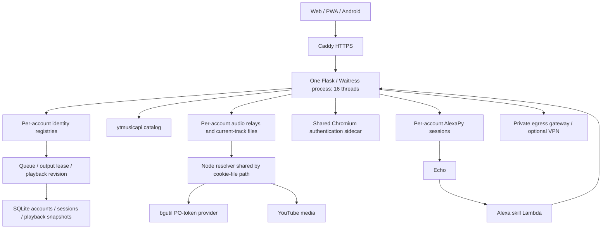

# Current architecture, security, and fix backlog

**Historical audit findings:** implementation followed this review. See [remediation and rollout status](SECURITY-ROLLOUT.md) for the current state.

Reviewed clean checkout `a17cc6c`. This updates the earlier [authentication review](SECURITY-REVIEW-2026-10-27.md). Application code was not changed. “Reproduced” means isolated synthetic accounts, temporary files/databases, or fake provider controllers. Source findings and recommendations are labeled separately; no production penetration test or live Google/Amazon login was performed.

## Architecture actually implemented

This is a modular monolith with helper processes. Keeping one authoritative playback process is appropriate for the present design. Additional WSGI processes/replicas would split locks, leases, session caches, and command authority. Redis/microservices are not prerequisites for the fixes below.

Useful boundaries already exist: progressive audio relay, bounded preparation jobs, queue occurrence IDs, output revisions, encrypted database provider secrets, staged provider credential replacement, and account artifact-purge retries. Preserve them.

## 1. Security fixes to do first

| Priority | Current issue / evidence | Required fix |
| --- | --- | --- |
| P1 | **Alternate email-change endpoint skips mailbox proof.** `multiuser/selfservice.py:1174` accepts password-only `/api/account/profile`, bypassing the code required by `/api/account/email/change`. Admin profile also uses the weaker service method. Reproduced: 200 and changed recovery email without an old-mailbox code. | One service-level policy for every entry point; stage and verify new email; notify old address; decide session invalidation centrally. |
| P1 | **Admin magic-link login skips enrolled TOTP.** `multiuser/admin.py:1872`. Reproduced on a TOTP-enabled owner. A valid email link alone creates an admin session. | Require the configured second factor after link verification. If email-only recovery is intentional, explicitly separate and restrict it. Avoid session-creating GETs. |
| P1 | **TOTP guessing limits reset after password success.** Player/admin login clears password/IP budgets before completing TOTP. Reproduced six second-factor attempts with a configured limit of three. | Independent per-account second-factor limiter, durable security failure state, and reset only after full login success. General IP request limits are not an adequate substitute. |
| P1 | **Accepted password proofs survive password changes.** Pending login records have no credential version. Reproduced successful second-factor completion with a token obtained before a password change. | Add a security generation to users, pending logins, sessions and tokens; increment it on relevant credential/recovery/revocation actions. |
| P1 | **Account revocation leaves scoped audio credentials valid.** `server.py:1441`, `audio_credentials.py`. Audio validates `web_sessions`, while account revocation updates `user_sessions`. Reproduced token acceptance after account-wide revocation. Token-only requests also default to owner identity. | Bind tokens to actual account, account session and security generation; establish their tenant context; minimize allowed routes. |
| P1 | **Switching accounts preserves legacy owner authentication.** Player login retains `remote_user`; `_logged_in` falls back to it after the account session fails. Reproduced owner fallback after player revocation. Requires an existing legacy-owner cookie. | Atomically replace authentication state on login and prohibit fallback to another identity after rejecting an explicit account session. |
| P1 | **Legacy yt-dlp credential files collide across accounts.** `server.py:4894` always writes `/tmp/yt_dlp_cookies.txt`. Reproduced: A's command references the same path overwritten with B's synthetic cookies. Affects legacy/provider-validation/metadata paths using this helper; normal Node streaming has a different path. | Unique restrictive temporary jar for each operation; keep it alive until the child exits; remove it in `finally`. Never share a writable temporary credential path across tenants. |
| P1/P2 | **TOTP disable/replace accepts password without an independent factor.** `accounts.py:1123,1246`. Password-only removal reproduced. Requires a valid session and password; this is an explicit weak recovery policy. | Existing authenticator, recovery code, or a clearly defined independent recovery proof; action-scoped step-up and session revocation on factor changes. |
| P2 | **TOTP replay counter is wrong.** `accounts.py:1291` records the current counter, although verifier accepts adjacent counters. Same code accepted at T and T+30 seconds. | Return and atomically consume the exact matched counter against the same secret/security generation. |
| P2 | **Expired TOTP setup can activate.** `confirm_totp_enrollment` uses a row fetched before expiry sweeping. Expired-secret activation reproduced. | Transactional expiry check and compare-and-set on the exact pending setup generation; bind setup to the initiating session. |
| P2 | **Forced password change is unenforced.** The flag does not restrict authenticated actions. Account API access with the flag set reproduced. | Restricted sessions that allow only required security completion and logout until the password is changed. |
| P2 | **Recovery leaks account existence through cookie state.** Forgot-password conditionally writes `mu_ss_pending_verify` with user ID/username; default Flask cookies are readable. Conditional state reproduced. | Opaque server-side recovery handles with indistinguishable response/state behavior; dummy password verification for unknown users. |
| P2 | **Plaintext generated/reset passwords enter Flask session cookies.** Admin password reset uses `flash(password)`; default Flask sessions are signed, not encrypted. Source confirmed. | Single-use server-side display record or direct no-store response; prohibit credentials in flash/session data. |

The previous review also found check-before-write races in last-owner preservation and signup daily caps, and invitation/reset proofs consumed before new-password strength validation. These source paths remain. Enforce invariants inside the same transaction and validate before spending proofs. Do not interpret the earlier report's severity labels as an assertion that every path is remotely exploitable without its stated prerequisites.

## 2. Provider sign-in and tenant boundaries

1. **One account can close another's YouTube browser — reproduced.** `youtube_browser_session.py:219` closes the global sidecar when revoking an unrelated identity. Logout reaches this code. Scripted stop similarly lacks an attempt capability. Introduce one coordinator for interactive, scripted and automatic sign-in; owner/profile/attempt ID must accompany every sidecar operation and candidate.
2. **Expired YouTube claims block other accounts — reproduced.** `start()` checks `_busy` before retiring the previous lease. Another account remained blocked after expiry. Expire the shared claim before admission and fence asynchronous cleanup with its attempt ID.
3. **Amazon form sign-in needs generation checks after awaits — source risk.** `alexa_remote.py:1062` captures a login, awaits provider work and promotes using mutable `_form_stage` without proving the attempt is still current. Old-tab answer/cancel and concurrent start/signout need deterministic race tests. Recent form parsing, split-password and robot-check improvements do not supply this fencing.
4. **Complete Alexa tenant attribution — protocol gap.** `lambda/mediaUtils/player.py:212` sends callbacks with the global API key; `server.py:1497` binds key-only requests to owner. Per-account AlexaPy objects alone do not isolate skill calls. Add verified Alexa-user/device/account mapping or a signed attempt/stream capability, carry it through armed play, next-track and state events, and reject unmapped/mismatched callers. Existing owner compatibility must be an explicit policy. No live multi-account Echo test was performed.
5. **Google secrets need origin checks — source risk.** `browser-auth/google_signin.py:339` submits into whichever page has a password field. Require exact HTTPS provider origin immediately before typing/submission, including redirect/frame handling. Do the equivalent for code submission and bound Amazon captcha fetch destinations and body size.

## 3. Architecture and reliability bugs

| Finding | Why it matters | Fix |
| --- | --- | --- |
| **Relay retirement retains objects and audio files — reproduced.** `youtube_stream.py:258,292`. `close()` does not close `current`; bound `atexit` callbacks keep evicted objects alive. | Account churn can retain buffers/files beyond the apparent four-entry pool bound. | Explicit retire/drain/close lifecycle; unregister exit callbacks; close current audio safely after active readers finish. |
| **Resolver LRU kills busy workers — source confirmed.** `server.py:124` closes evicted workers regardless of pending requests. | A fifth distinct credential can interrupt another account's resolution. | Track borrowers/in-flight work; evict idle resolvers; bound admission and close outside the registry lock. |
| **No global audio admission budget — source confirmed.** Eight slots exist per relay, versus 16 Waitress threads. Recreated facades receive fresh semaphores. | Multiple accounts/slow streams can consume control capacity; reported pool slots use `max`, masking aggregate capacity. | Global plus per-account limits, bounded waits and dedicated control capacity. Load-test slow readers and disconnect storms. |
| **PO-token work competes with the Python RPC deadline — source risk.** Node provider calls may take ten seconds after metadata/decipher, while Python's whole resolve timeout is ten seconds. | A slow provider can kill the shared worker, affecting unrelated requests despite “optional provider” comments. | One end-to-end deadline, smaller stage budgets, provider circuit breaker, cancellation and error classification. Test with deliberately delayed provider replies. |
| **Persistence submission still opens SQLite — reproduced.** `playback_store.py:158` calls `dead()`, which evicts its negative cache result. Two repeated checks opened two connections. | Database work remains on request/heartbeat paths, under playback locks, despite the coalescing writer. | Durable deletion generations plus valid negative caching; keep normal submissions in memory. |
| **Persistence connections lack explicit close — source confirmed.** `_connection()` returns SQLite connections used as context managers. SQLite's transaction context does not itself close them. | Cleanup depends on object destruction/GC; avoid needless connection and descriptor pressure. | Explicit closing context; perform schema migration once; measure connection/writer latency. |
| **Potentially unbounded legacy subprocess — source confirmed.** `resolve_direct_url()` has no subprocess wall-clock timeout. | Network/plugin/runtime stalls can retain a request worker. | Deadline-bound child execution, bounded output and cancellation/cleanup. |
| **Monolithic composition and implicit identity.** `server.py` is 13,087 lines; state is selected by context proxies defaulting to owner. | Easy to miss tenant propagation, authorization, and lock ordering during changes. | Extract auth policies, playback coordinator, provider sessions and streaming pools into services; routes stay adapters. Pass explicit principal/identity across service and background-job boundaries. |

## 4. Additions needed

- **A committed adversarial regression suite.** Cover every demonstrated failure above; route-policy parity; cross-account access; stale tabs; password changes between login steps; TOTP races; account deletion during provider promotion; lost logout; and capability use after revocation/restart. Temporary audit probes are evidence, not a permanent CI gate.
- **API and authorization contracts.** Document every route's principal, tenant, capability, mutation method, CSRF requirement and error schema. Add a machine-checked access matrix and protocol versions for web/Android/Lambda rollouts.
- **Dedicated browser network.** `youtube-browser` currently shares external `web` networking; noVNC exposes an unauthenticated viewer inside that network, relying on Caddy forward-auth for public access. Move controller/viewer paths onto private networks and restrict peers. This is conditional lateral-access risk, not proof of direct public VNC exposure.
- **Reproducible, scanned builds.** Python dependencies are largely unpinned; provider image uses `latest`; base images float; Docker fetches an install script. Add reviewed lockfiles/digests, dependency/container/secret scans, SBOM and update workflow. No CVE scan was run, so no specific vulnerable version is claimed.
- **Container least privilege and capacity limits.** Application/browser images have no non-root `USER`; Chromium uses `--no-sandbox`; compose lacks explicit service CPU/memory/PID budgets. Add non-root execution, supported browser isolation, capability reduction, restricted writable paths and tested limits.
- **CI coverage for infrastructure-only changes.** Workflow path filters omit `browser-auth/**`, `network-egress/**`, compose and Caddy changes. Include these and validate container startup/health, private-port exposure and proxy auth. Security tests must exercise full routes, not only AST-extracted methods with fake owners.
- **Recovery and key operations.** Require a separate provider encryption key in production; add tested key rotation, encrypted backup/export handling, retention policy, whole-system restore drills and post-restore revocation. Existing database backup/0600 handling is useful but does not by itself prove recoverability of provider files/profiles.
- **Fail-closed configured auth.** Explicitly enabled multi-user initialization must fail readiness/startup on error instead of silently continuing as legacy (`server.py:13071`). Test startup with invalid keys, migration failures and unavailable storage.
- **Operational visibility.** Add separate liveness/readiness, per-stage stream timings, active/retiring pool counts, global admission saturation, provider retries, purge backlog and sanitized auth-failure counters. Distinguish request acceptance, first byte, renderer confirmation and audible playback.
- **Update `ARCHITECTURE.md`.** It still claims an older verified commit, one current file and four concurrent resolutions. Document actual per-account state/buffers, shared credential resolvers, PO-token service, dual session systems and the unresolved Lambda identity contract.

## Validation and recommended order

Re-ran three temporary authentication probes against this checkout. They reproduced email-change bypass, magic-link/TOTP bypass, second-factor budget reset, stale password proof, TOTP replay/expired setup, password-only TOTP removal, ineffective forced-password flag, conditional recovery state, audio-token revocation failure, retained legacy owner identity, unrelated browser close and stale browser claim.

Additional probes reproduced shared cookie-file overwrite, retained relay/file cleanup, and repeated SQLite reads. **128 focused tests passed across 11 isolated files:** shared resolver, egress, current audio, playback store/output/lock contract, queue commands, audio credentials, Amazon form login, YouTube browser session and extraction clients. These passes do not invalidate the failing boundary probes. Resolver Node tests were not run here: local Node is 18 rather than the project's 22 and resolver dependencies are absent. No full browser/device/load/dependency audit was performed.

Recommended implementation order: **(1)** central auth policy/security generations and cookie isolation, **(2)** provider attempt/tenant binding, **(3)** lifecycle/admission/deadline fixes, **(4)** transactional persistence/invariants, **(5)** deployment and CI hardening, **(6)** incremental service extraction. Keep one authoritative playback process until explicit shared-state coordination exists.
